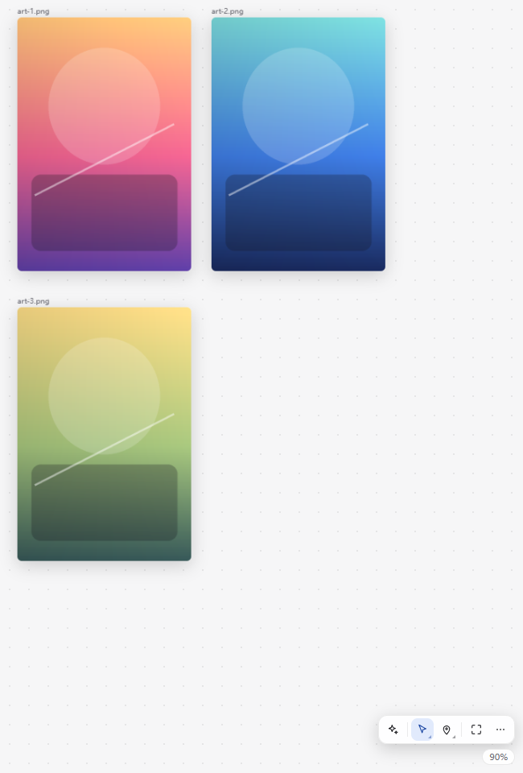
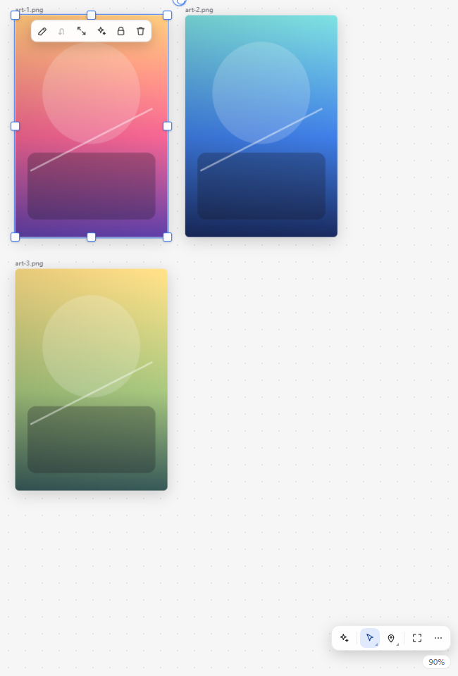
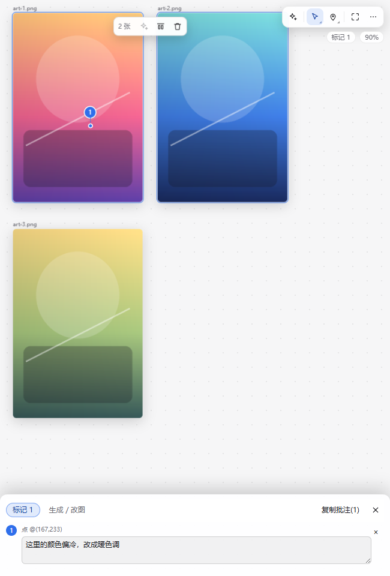
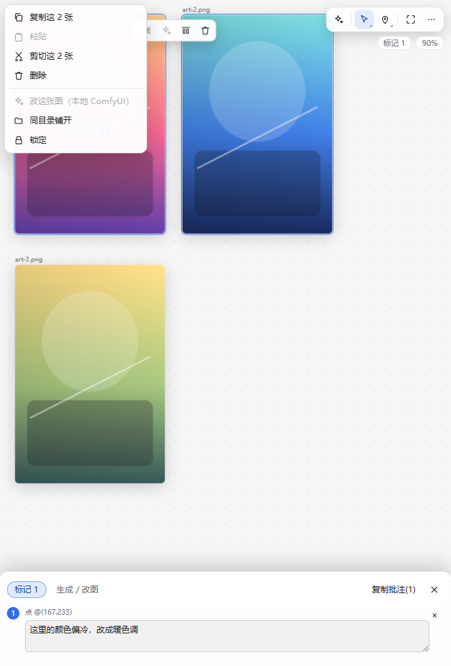
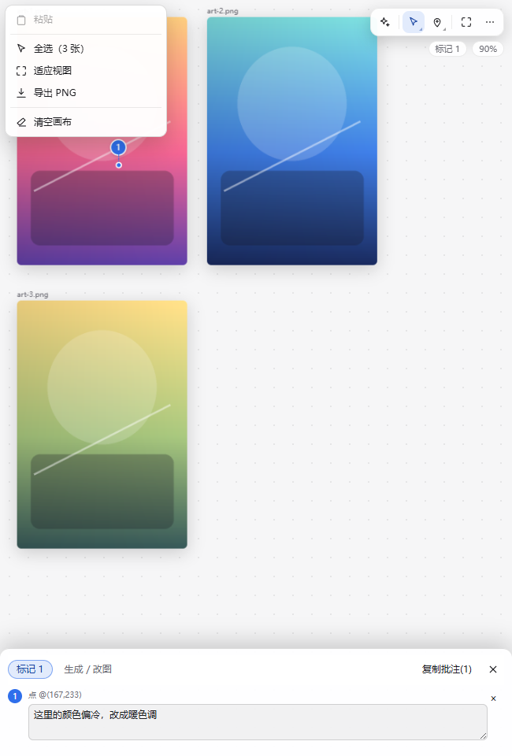
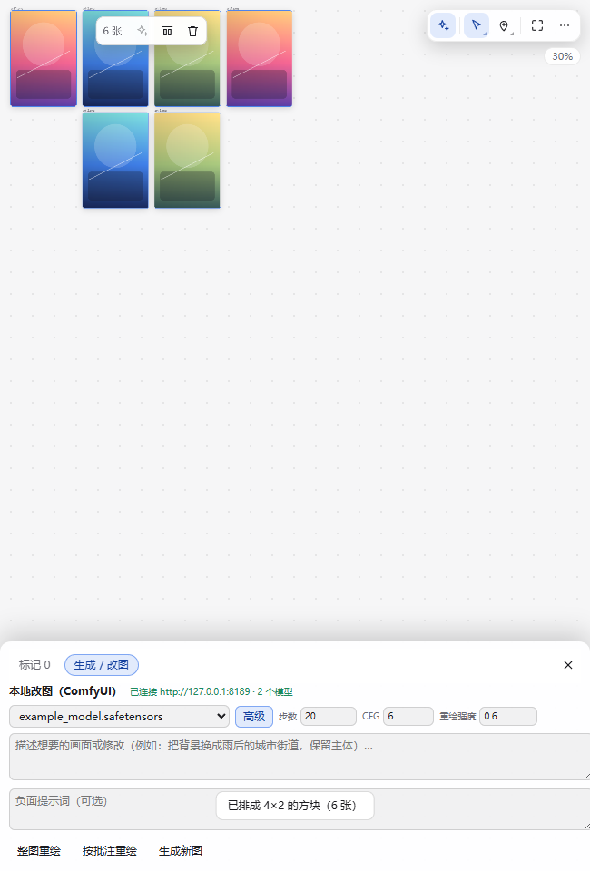

# dsh-image-canvas

> **DSH 桌面版右侧边栏的「无限画布」**：打开的图片会落到同一张可平移缩放的画布上，可以在图上批注、
> 用本机 ComfyUI 直接改图/出图，一键把批注变成给 Agent 的提示词。除 ComfyUI 推理外全部本地完成，
> **不需要任何云端 API Key**。

[](LICENSE)
-0f1115)




灵感与交互参考自 [KaichenCurry/dsh-design-mode](https://github.com/KaichenCurry/dsh-design-mode)（画布 + 图上批注 + 版本树），
但那个是整仓 fork（0.1.1-rc.2，需要跑独立实例）；本插件是**为 DSH 桌面版 0.2.x 重写的独立插件**，
走官方右侧栏 tab 契约，直接装进你现在用的桌面版。

## 截图

| | |
|---|---|
|  |  |
| 选中图片：上方浮出操作条，可编辑 / 回正 / 原尺寸 / 引用生成 / 锁定 / 消除 | 标记批注：编号徽标 + 说明，标记列表与「复制批注」 |
|  |  |
| 图片 / 多选右键：复制·粘贴·剪切·删除 + 改图 / 同目录铺开 / 锁定 | 画布空白右键：粘贴 / 全选 / 适应视图 / 导出 PNG / 清空画布 |
|  | |
| 本地 ComfyUI 改图浮层：整图重绘 / 按批注重绘 / 生成新图 | |

（截图由插件自带的 `tools/preview.mjs` 渲染生成，示例图片为占位图，不含任何个人素材。）

## 它做什么

| 能力 | 说明 |
|---|---|
| **图片自动汇入** | 在对话/文件树/交付物里打开 `png/jpg/jpeg/jfif/jpe/gif/webp/bmp/ico/svg/avif/apng`（浏览器直接解码）或 `tif/tiff`（宿主 sharp 转码）都会落到**同一张画布**上；同一张图重复打开不会重复添加 |
| **无限画布** | 滚轮以指针为中心缩放、手/中键拖动平移、适应视图、真实百分比显示 |
| **节点操作** | 单选时四周 **8 个缩放手柄**（4 角 + 4 边中点：角上等比、按住 Shift 放开比例、边上只改一个方向）+ 右上角外侧的**旋转点**（圆形箭头图标，Shift 吸附 15°）；拖动、锁定、删除、`F` 聚焦 |
| **撤销/重做** | Ctrl+Z / Ctrl+Y，最多 60 步 |
| **批注** | 点 / 框选 / 涂抹三种锚点；编号标记；每条可写说明；列表在「标记」浮层里，可删除 |
| **本地改图（ComfyUI）** | 三种动作：**整图重绘**（img2img）、**按批注重绘**（框选/涂抹当掩码做局部重绘）、**生成新图**（txt2img）。结果自动作为新节点落在源图右边 |
| **交给 Agent** | 一键把批注整理成提示词复制到剪贴板（带画布坐标），粘贴进对话即可让模型按意见处理 |
| **导出** | 把可见图片合成为一张 PNG 下载（含旋转，本地合成） |
| **持久化** | 按会话保存：宿主路由 `<DSH_HOME>/storages/dsh-image-canvas/<会话>.json`，宿主不可用时回落 localStorage；AI 产出图片落在同目录 `out/<会话>/` 并由插件路由取回 |
| **面板外右键** | 在画布面板以外（聊天/文件树）的内容图上右键：**放入无限画布** / **复制图片地址** |
| **3D 模型预览**（0.6.0） | 在画布上直接打开 `glb/gltf/fbx/obj/stl/ply`：节点里是一块 three.js 视口，自动居中贴地；**选中后可左键旋转 / 右键平移 / 滚轮缩放**。入口：对话里点开 3D 文件、右下角立方体按钮（扫描目录 / 粘路径）、「⋯ → 打开 3D 模型…」 |

## 3D 模型预览（2026-10-28 新增）

画布节点不再只能是图片：3D 文件会渲染成一块**真的 WebGL 视口**（three.js r169，本地渲染，不联网）。

| 项 | 说明 |
|---|---|
| 认的格式 | `glb` `gltf` `fbx` `obj` `stl` `ply` |
| 交互 | 选中节点后：左键拖动旋转、右键拖动平移、滚轮缩放；未选中时节点不吃指针事件（画布拖动/拉框照常穿过） |
| 自动适配 | 按包围盒居中、脚底落到地面网格、相机按最大边长选距离；节点缩放/画布缩放都会按比例提升渲染像素比 |
| 主题 | 深色（近黑底 + 暗网格）/ 浅色（浅灰底 + 浅网格）自动跟随画布主题 |
| 入口 | ① 对话里点开 3D 文件 → 自动汇入画布；② 右下角**立方体按钮** → 扫描目录（可填绝对路径）或粘路径；③ `⋯ → 打开 3D 模型…` |
| 上限 | 单模型 96 MiB；`.blend` 不收（Blender 私有格式，先导出 glb）；`.gltf` 的外部 `.bin`/贴图拉不到时请用 `.glb`；每个节点一个 WebGL 上下文，节点隐藏即释放 |
| 自动打开 | 画布文档里出现 3D 节点时，**右侧栏会自己弹出一次**（每个会话一次）—— 否则用户根本不知道模型已经落到画布上了 |

运行时放在插件自带的 `vendor/`（three + 各格式 loader，1.9 MB），由宿主 prefix 路由
`/plugins/dsh-image-canvas/vendor/` 发出；宿主还没重启（路由 404）时，客户端会退回
「从工作区读 vendor 文本 → 拼成 blob 模块树再 `import()`」，所以改完客户端即可用、不必等重启。
升级 three 的步骤见 `vendor/README.md`。

## 图片格式支持（2026-10-21 更新）

按**文件头魔术字节**判断真实格式，不依赖扩展名（改过后缀的图也能认）：

| 处理方式 | 格式 | 说明 |
|---|---|---|
| 浏览器直接解码 | `png` `apng` `jpg` `jpeg` `jfif` `jpe` `gif` `webp` `bmp` `ico` `svg` `avif` | Chromium 原生支持，画布直接用 Blob 显示 |
| 宿主转 PNG（sharp / libvips） | `tif` `tiff` | 常见压缩都实测过：未压缩 / LZW / Deflate / PackBits / JPEG-in-TIFF / CMYK / 带 alpha / 多页（取第一页） |
| 暂不支持 | `heic` `heif`（HEVC）、`psd` `exr` `hdr` `dds` `tga` `jxl` | 见「已知限制」 |

另外两条 2026-10-21 修的加载问题：

- **大图**：官方 `readBytes` 整文件上限 32 MiB，超过会报 `too-large`。画布现在自动退化成 **1 MiB 分块读**再拼回来，
  单张图上限放宽到 256 MiB（再大直接给错误提示，不硬撑）。
- **路径被 Markdown 吃坏**：聊天里写 `` 时，Markdown 会把 `\_` 当转义，
  分隔符丢失 → `B:/ComfyUI_cloud_test/x.png`（文件明明在却 not-found）。画布现在读失败时会在 ASCII 标点前
  逐个补回 `/` 探测，命中就**自动修好并把文档里的坏地址改对**（提示「图片路径已自动修复」）。

## 安装

**前置**：DSH 桌面版（0.2.x；在 0.2.0-rc.2 上开发验证）、可选的本机 ComfyUI（默认 `127.0.0.1:8189`）、Node.js ≥ 20（仅开发自检需要）。

1. 把仓库克隆到本地任意目录（不要放进 profile 的 `node_modules`）：

   ```powershell
   git clone https://github.com/Link-h1j/dsh-image-canvas.git D:\plugins\dsh-image-canvas
   ```

2. **可选：装转码依赖（为了打开 tif/tiff）**
   ```powershell
   cd D:\plugins\dsh-image-canvas
   npm install            # 会装 sharp（约 30 MB，含 libvips 原生模块）
   ```
   不装也能用，只是 TIFF 打开时会明确提示「图片转码器不可用（没装 sharp…）」；浏览器原生格式不受影响。

3. DSH 左侧栏 **插件 → 添加插件**，填**该目录的绝对路径**（例如 `D:\plugins\dsh-image-canvas`），
   按提示启用。插件管理器支持本地目录（bundle）安装；也可以让 DSH Agent 用插件管理器从目录安装。

4. **若右侧栏面板迟迟不出现、或新格式（TIFF）报「转码服务还没启动」，请完整重启一次桌面版**——
   宿主半边（探活 + 转码路由）要重启才会挂载；浏览器半边（画布 UI）会自动热更。

### 装完怎么验

```powershell
# 1) 宿主路由是否挂上（端口换成你本机 DSH Web GUI 的实际端口）
Invoke-RestMethod http://127.0.0.1:<端口>/plugins/dsh-image-canvas/probe
# 期望：{"ok":true,"plugin":"dsh-image-canvas","version":"0.6.0","store":"...storages\dsh-image-canvas","vendor":"...\vendor"}

# 2) 插件是否进了 profile
(Get-Content "$env:USERPROFILE\.dsh\profiles\desktop\package.json" -Raw | ConvertFrom-Json).dsh.profile.bundles -contains 'dsh-image-canvas'
# 期望：True
```

## 怎么用

1. 右侧栏的添加控件（「+」）→ 选 **无限画布** 打开一张常驻画布。
2. 在对话里让 Agent 生成/打开一张图片，或在文件树里点开一张图 → 它会自动落到这张画布上。
3. **选择**工具下：点图选中、拖图移动、空白处拖框多选；选中后图片上方有操作条。
   切到 **标记 / 框选 / 涂抹** 在图上标注，标记浮层会自动弹出让你写清要改什么。
4. 点 **复制批注(N)** → 回到对话粘贴 → 让 Agent 按批注处理；
   或点 **生成 / 改图**（本地 ComfyUI）直接出图。
5. **⋯ → 导出 PNG** 把当前画布合成一张图下载。

## 界面与操作

```
┌──────────────────────────────────────────┐
│                                          │
│            画布占满整块面板               │
│       （滚轮缩放 · 手/中键拖动平移）        │
│                  ┌──────────────┐        │
│                  │ ▸ 标记         │        │ ← 悬停/点分组 → 向上展开成员
│                  │ ▢ 框选         │        │
│                  │ ✎ 涂抹         │        │
│                  └──────────────┘        │
│                   ┌──────────────┐       │
│                   │✨ ▸◣ ◉◣ ⤢ ⋯ │       │ ← 右下角 5 个按钮（分组带小三角）
│                   └──────────────┘       │
│                              标记 3   82% │ ← 状态胶囊（点 = 适应视图）
└──────────────────────────────────────────┘
```

- **✨ 生成 / 改图**：底部浮层（本地 ComfyUI），默认收起；参数收在「高级」里
- **▸ 指针组**：选择（默认）/ 拖动 两个工具，悬停或点击向上展开挑成员
  - 选择：空白处拖 = 拉框多选（Shift 加选/减选）；点图选中；拖图移动；多选整组一起动
  - 拖动：按住平移画布；中键拖动、Alt 拖动在任何工具下也能平移
- **📍 批注组**：标记 / 框选 / 涂抹；激活时图片不吃指针事件、光标为十字，可放心在图上落点/画框
- **⤢ 适应视图**、**⋯ 更多**：导出 PNG / 同目录 / 重载 / 撤销重做 / 主题 / 清空 / 自检信息
- **右键菜单**（对齐豆包）：
  - 图片 / 框选多张：复制 · 粘贴 · 剪切 · 删除（多选时显示"复制这 N 张"）+ 改这张图 / 同目录铺开 / 锁定
  - 画布空白：粘贴 + 全选 / 适应视图 / 导出 PNG / 清空画布
  - 浏览器原生菜单在任何位置都不出现；画布自带剪贴板，`Ctrl+C / Ctrl+X / Ctrl+V` 同效
- **选中工具条**：挂在选中区上方居中；一张时：编辑 / 回正 / 原尺寸 / 引用生成 / 锁定 / 消除
- **框选多张**：工具条变成「N 张 / 引用生成（置灰）/ 智能对齐 / 消除」；智能对齐 = 排成矩形图片墙
- **标记**：编号徽标 + 虚线引线 + 落点圆点画在图上，标记浮层自动弹出写说明

## 本地改图（ComfyUI）

点右下角 **✨** 打开「生成 / 改图」浮层：选模型 → 写提示词 → 点动作按钮。
步数 / CFG / 重绘强度 / 负面提示词收在 **高级** 里。三个动作：

| 按钮 | 走什么 | 适用 |
|---|---|---|
| **整图重绘** | img2img（源图上传 → VAEEncode → KSampler） | 整体改风格/配色/氛围，靠**重绘强度**（默认 0.6）控制幅度 |
| **按批注重绘** | inpaint（框选/涂抹变成掩码 → SetLatentNoiseMask） | 只改指定区域，其余像素不动 |
| **生成新图** | txt2img（832×1216 空潜变量） | 从零出一张，落到画布上继续改 |

结果作为新节点插在源图右边（名字前缀 `AI ·`），图片存在 `<DSH_HOME>/storages/dsh-image-canvas/out/<会话>/`，
刷新/重启后依然在。用的是**最通用的核心节点**（CheckpointLoaderSimple / CLIPTextEncode / KSampler /
VAEEncode / ImageToMask / SetLatentNoiseMask / VAEDecode / SaveImage），不依赖自定义节点；
SD1.5 / SDXL / Flux 的 checkpoint 都能选。

### 先启动 ComfyUI（必须）

插件不负责启动 ComfyUI，用你平时的方式启动即可（默认连 `http://127.0.0.1:8189`）：

```powershell
$env:PYTHONUTF8 = "1"          # Windows 中文控制台是 GBK，自定义节点打 emoji 会让 ComfyUI 崩掉
python main.py --port 8189
```

> 在 Windows 上如果没设 `PYTHONUTF8=1`，会看到 `UnicodeEncodeError: 'gbk' codec can't encode character ...`
> 直接把 ComfyUI 干掉（实测）。

要换地址设环境变量 `DSH_IMAGE_CANVAS_COMFY`（宿主半边启动时读取，改完需重启桌面版）。

### 环境变量

| 变量 | 默认值 | 说明 |
|---|---|---|
| `DSH_IMAGE_CANVAS_COMFY` | `http://127.0.0.1:8189` | ComfyUI 服务地址（宿主重启生效） |
| `DSH_IMAGE_CANVAS_JSDOM_ROOT` | `<插件>/../apps/dsh-design-mode` | 开发自检：含 jsdom 的工程目录 |
| `DSH_IMAGE_CANVAS_REACT_ROOT` | `<插件>/../apps/infinite-canvas/web` | 开发自检：含 react/react-dom 的工程目录 |

## 配色

画布**跟随系统配色**（`prefers-color-scheme`）：浅色系统白底、深色系统深底。
「主题」在 **⋯** 菜单里，循环切换 **跟随系统 → 浅色 → 深色**，选择会记住（localStorage）。
导出 PNG 的底色也跟主题走；图上批注的高对比色保持不变。

## 快捷键

| 键 | 作用 |
|---|---|
| 滚轮 | 以指针为中心缩放 |
| 手工具 / 中键拖动 / Alt 拖动 | 平移画布 |
| 拖动图片时 | 自动磁吸对齐（边/中线/视口中心，屏幕 7px 内）+ 参考线；按住 `Alt` 关掉磁吸 |
| 选择工具：空白处左键拖动 | 拉框多选 |
| 选择工具：`Shift` 点图片 | 加选 / 减选 |
| 右键图片 / 右键空白 | 图片菜单 / 画布菜单 |
| `Ctrl+C` / `Ctrl+X` / `Ctrl+V` | 复制 / 剪切 / 粘贴选中的图片（内置剪贴板） |
| `F` | 聚焦选中节点（多选时铺满整组包围盒） |
| `Delete` / `Backspace` | 删除选中节点 |
| `Ctrl+Z` / `Ctrl+Y` | 撤销 / 重做 |
| `Esc` | 依次收：右键菜单 → 分组浮层 → ⋯ 菜单 → 取消选择 / 回到选择工具 |

## 已知限制

- **改图依赖本机 ComfyUI**：没启动时画布照常可用，三个动作按钮置灰。
- 一次只跑一单（浮层有忙碌态）；换 checkpoint 需要重新加载模型，第一张会慢十几秒。
- **只认 session scope 的工作区文件**（`dsh-resource://file/session/...`）；`absolute` scope 没有会话，不会被接管。
- **大图**：整文件读取走 1 MiB 分块（宿主 32 MiB 上限已被绕开），单张图封顶 256 MiB；超了给明确错误而不是卡死。
- **HEIC/HEIF 解不了**：DSH 自带的 libvips 没编 HEVC 解码器（2026-10-21 实测报
  `Support for this compression format has not been built in: HEVC`），HEIC/HEIF 请先转成 PNG/JPG。
  同理 `psd` `exr` `hdr` `dds` `tga` `jxl` 也不在支持列表里（sharp 的 libvips 没带这些 loader）。
- 画布状态按会话隔离；换会话 = 换一张画布。
- 目前没有版本树；但每次 AI 改图都会留一个新节点，等于一条简单的版本链。

## 开发

```powershell
node tools/build-client.mjs         # 改完 lib/client.body.js 必须跑这个（带语法闸门）
node tools/build-client.mjs --check # 只核对产物是否最新
node tools/selftest-helpers.mjs     # 纯函数：magic bytes / 路径自愈 / 分块拼接，47 项，~0.3 s
node tools/selftest.mjs             # 客户端半边：jsdom + 真 React 渲染，213 项断言（含 3D 节点接线）
node tools/selftest-host.mjs        # 宿主半边：路由 / 探活 / 原子写 / 转码 / vendor 静态资源，23 项断言
node tools/verify-vendor-tree.mjs   # 3D 运行时：vendor 依赖闭包 + blob 模块树可拼装 + 19 个文件都能 import
node tools/selftest-comfy.mjs       # 真实 ComfyUI 端到端：文生图 → 图生图 → 局部重绘（需 ComfyUI 在跑）
node tools/probe-comfy.mjs          # 只读探测：ComfyUI 版本/设备/节点/可用模型
node tools/preview.mjs              # 视觉预览：jsdom 渲染 → 静态 HTML → 本机 Chromium 截图（12 个状态）
node tools/restore-body.mjs         # 意外改坏 client.body.js 时，从 lib/client.js 反解恢复

npm run verify                      # = check + verify:vendor + selftest:helpers + selftest:host + selftest（提交前跑这个）
```

- `tools/preview.mjs` / `tools/selftest.mjs` 需要 jsdom 与 react/react-dom，可用
  `DSH_IMAGE_CANVAS_JSDOM_ROOT` / `DSH_IMAGE_CANVAS_REACT_ROOT` 指向包含它们的工程目录（默认指向作者的开发布局）。
- 预览用图放在 `--out` 目录的 `img/` 下（任意 png），截图落到同一目录。

### 改文件的规矩

- **只改 `lib/client.body.js`**，`lib/client.js` 是生成物（HMR 也只看它）。
- 浏览器半边是 CJS 形态（`require` / `module.exports`），只能 require 平台模块表里的包（本插件只用了 `react`）。
- 宿主半边（`lib/index.js`）改动**必须完整重启桌面版**才生效；浏览器半边改完约 1 秒自动热更。
- 不要用 PowerShell 5.1 的 `Get-Content`/`Set-Content` 改这些无 BOM 的 UTF-8 中文文件（会按 GBK 解释并丢字）。

## 卸载

插件管理器里移除即可；如有残留，删除 `$DSH_HOME/storages/dsh-image-canvas`（画布快照）与浏览器里的 `dsh-image-canvas:*` localStorage 键。

## 更新记录

见 [CHANGELOG.md](CHANGELOG.md)。

## 相关插件

- [dsh-comfy](https://github.com/Link-h1j/dsh-comfy) —— 同一个右侧栏里的 ComfyUI 工作流画布：
  浏览/改参数/运行本机 ComfyUI 工作流，结果图直接落到画布上，可再拖进本无限画布继续批注和改图。

## License

[MIT](LICENSE) © 2026 Link-h1j
